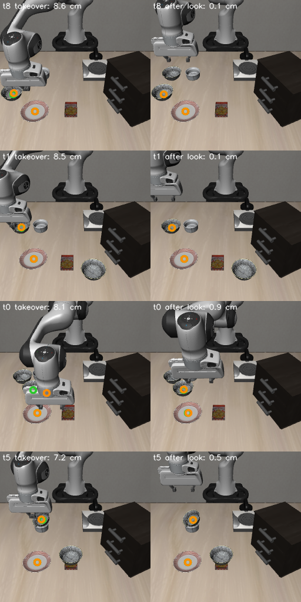

# Planning phone takes from camera images instead of simulator state

The main pipeline plans each take from numbers it reads out of the simulator (`replay.scene_of`: the target
bowl's centre, the plate's centre, and the bowl's and plate's lowest points). On this branch a small CNN
(`src/phone2libero/scene.py`, 0.9 M parameters) estimates those numbers from the robot's agentview image and the
task id, and the phone demos and the round-2 recoveries are rebuilt from its estimates.

## Result

Round 2's recipe (5-shot + phone demos on 8 tasks + round 1's own successes + recoveries, 60k steps, same training
seed), with every phone take planned from the estimate, on the same 1000 test episodes at `n_action_steps` 25:

| Model | Success | t0 | t1 | t2 | t3 | t4 | t5 | t6 | t7 | t8 | t9 |
|---|---|---|---|---|---|---|---|---|---|---|---|
| round 2 (released), planned from sim state | 96.1 | 99 | 100 | 91 | 95 | 88 | 99 | 98 | 96 | 99 | 96 |
| round 2, training seed 2 | 92.1 | 97 | 100 | 88 | 99 | 63 | 97 | 98 | 94 | 94 | 91 |
| round 2, training seed 3 | 92.8 | 99 | 98 | 81 | 99 | 73 | 98 | 100 | 97 | 94 | 89 |
| **round 2, planned from the estimate** | **94.4** | 100 | 100 | 91 | 99 | 72 | 98 | 96 | 95 | 98 | 95 |

- Against the released model: -1.7 points [-3.6, +0.2] (paired by scene, 95% interval, evaluation noise only).
  It is within the 92.1-96.1% of the three sim-planned runs. One training run.
- Most of the gap is task 4 (72 vs 88), which gets no phone demos and no recoveries in either version, so its data
  is the same. It is the least stable task across training seeds (88, 63, 73). On the other nine tasks the two
  models have 872 and 873 successes.
- The data: 160 phone demos (20 per task, as on main) and 115 recoveries from 144 takeover states (main: 123 from
  143); round 1's own successes are identical, since its rollouts reproduce exactly.

What still reads the simulator:

- The CNN's training labels: frames rendered from init states 10-39 and labelled with the sim's positions. Those
  scenes overlap the init states the phone data is made on (10-49), though not the test episodes (0-9).
- The replay checks (lifted 5 cm, no slip, nothing else moved), by design: they judge the outcome, as LIBERO's
  success test does.
- When to take over (`recover.py` compares the gripper's height with the bowl's), and task 4's carry steering.

## The estimator

- Input: the agentview image (256 px, area-downsampled to 128) and the task id.
- Two task-conditioned heatmaps locate the target bowl's and the plate's centres in the image (soft-argmax plus a
  sub-cell offset); a small head predicts their heights; the fixed, calibrated camera puts each centre on its
  pixel's ray at that height. The geometry runs in float32: under bf16 a 1 m coordinate resolves only to ~0.4 cm.
- Training frames: 51,219 from 300 scenes (init states 10-39; validation 16,836 from init states 40-49). The
  reset frame; the policy's own successful episodes replayed, as recorded and with the bowl nudged 1.5-5 cm at
  reset; phone takes planned from sim state, and 2.5-5 cm off (misses, as before a takeover); objects moved at
  reset with the arm sweeping to random points. One frame every 5 steps. Augmentation: lighting and sensor noise
  only (the camera is fixed). One training run, 20k steps, about 10 minutes.

## Accuracy and replay checks

All on init states 40-49. The reference is a per-task constant (the mean over init states 10-39), since at reset
the bowl moves only about 1 cm between init states.

| | sim state | estimate | per-task constant |
|---|---|---|---|
| bowl centre error at reset, cm (100 scenes) | 0 | 0.12 (p90 0.22) | 1.40 |
| plate centre error at reset, cm | 0 | 0.04 | 1.13 |
| Check A: replays passing, planned at reset (1,100 paired) | 80.2% | 78.9% | 67.5% |
| Check B: takeover states recovered (222), planned from the takeover frame | 91.9% | 87.4% | 71.2% |
| Check B, the hand lifted out of view for 1 s first | 90.5% | 88.7% | 73.9% |

The replays need this precision: 1 cm of noise per axis on the sim scene drops Check A's pass rate from 80.5% to
63.9%, and the per-task constant costs 12 points. Estimate against sim, per replay: -1.3 points [-2.5, -0.0] at
reset; -2.9 [-5.5, +0.3] at takeover states.

The takeover gap is occlusion: a closed gripper above the bowl hides it from the agentview camera (task 8 most).
Opening the gripper and moving the hand 10 cm up and back before taking the frame cuts the estimate's error there
from 0.61 to 0.17 cm, and the states more than 2 cm off from 14 of 222 to 0. Four of the worst, before and after
the lift (orange: estimated centres, green: true; the error is the bowl's, in cm):



The 94.4% run did not use this lift: its recoveries are planned from the takeover frame, as in Check B's first row.

## What didn't work

- A wrist camera (wrist image and proprio added): no better overall (0.74 vs 0.72 cm on all validation frames) and
  worse at takeover-like frames (2.20 vs 1.72 cm); in the occluded frames it mostly does not see the bowl either.
- Frames with objects moved at reset are the worst source (4.7 cm mean): bowls knocked far from anywhere they
  appear in training.
- A long tail: at takeover-like frames the median error is 0.1 cm, but 36 of 1,418 are more than 5 cm off, a few
  absurdly when the heatmap lands near the horizon and the pixel's ray meets the bowl's height far away.

## Reproduce

From the repo root, after the main pipeline (`uv run just retarget`, the self-play rounds and `recover`):

```bash
uv run python -m phone2libero.scene generate --split train     # labelled frames -> outputs/scene/data
uv run python -m phone2libero.scene generate --split val
uv run python -m phone2libero.scene train --name a128          # -> outputs/scene/models/a128.pt
uv run python -m phone2libero.scene accuracy a128
uv run python -m phone2libero.scene check-reset --name a128
uv run python -m phone2libero.scene check-takeover --name a128 # add --look for the lift first
uv run python -m phone2libero.scene demos --name a128          # phone demos -> outputs/scene/phone/t<task>
uv run python -m phone2libero.recover --policy outputs/train/round1/checkpoints/last/pretrained_model \
    --n-action-steps 25 --overwrite --own data/est/own --recovered data/est/recovered \
    --estimator outputs/scene/models/a128.pt
uv run just train est 60000 outputs/scene/phone/t0 outputs/scene/phone/t1 outputs/scene/phone/t2 \
    outputs/scene/phone/t3 outputs/scene/phone/t5 outputs/scene/phone/t6 outputs/scene/phone/t7 \
    outputs/scene/phone/t8 data/est/own data/est/recovered
uv run just eval outputs/train/est/checkpoints/last/pretrained_model est 25
```

`generate` replays the policy's own successful episodes from the local datasets listed in `scene.OWN`; on Hugging
Face these are `selfplay_baseline_tasks4_9`, `selfplay_round1` and `selfplay_round2` in
[phone2libero-demos](https://huggingface.co/datasets/kishan-grewal/phone2libero-demos). Round 3's own successes
were also used and are not published, so a rerun has somewhat fewer replayed frames.
