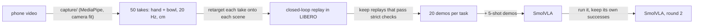

# phone2libero

I filmed my hand moving a bowl onto a plate with a phone, turned the 50 takes into robot demonstrations in
the LIBERO simulator, and used them to train a SmolVLA policy. On the ten libero_spatial tasks, success goes from
**62.2% to 78.1%** over the same 1000 evaluation episodes.


| Model (SmolVLA, same recipe) | Training data | Success, 1000 episodes | vs baseline (paired, 95% CI) |
|---|---|---|---|
| Baseline | 50 LIBERO demos (5 per task) | 62.2% | |
| + phone demos | + 160 retargeted phone demos (8 tasks) + 40 of the baseline's own successes (tasks 4, 9) | 76.3% | +14.1 [+10.7, +17.5] |
| + one self-improvement round | + 200 of that model's own successes, replacing the 40 | 78.1% | +15.9 [+12.6, +19.4] |


Every model is evaluated on 10 seeds x 10 init states x 10 tasks, the same 1000 episodes for every model, and
init states 0-9 are never used to make data. Differences are paired by episode (same scene, same
seed) with a bootstrap interval. Per-run tables: [Results in detail](#results-in-detail).

## Try it

Needs Linux, an NVIDIA GPU and [uv](https://docs.astral.sh/uv/).

```bash
git clone https://github.com/kishan-grewal/phone2libero && cd phone2libero
uv sync
uv run just demo          # the trained policy in LIBERO, 10 episodes of one task (~1 min, videos in outputs/evals/)
uv run just replay-take   # one of my takes retargeted onto a LIBERO scene (~20 s, no model, video in outputs/replay/)
```

`uv run just` lists everything else. The model, datasets and recordings are on Hugging Face:
[phone2libero-smolvla](https://huggingface.co/kishan-grewal/phone2libero-smolvla),
[phone2libero-demos](https://huggingface.co/datasets/kishan-grewal/phone2libero-demos),
[phone2libero-recordings](https://huggingface.co/datasets/kishan-grewal/phone2libero-recordings).

## How it works



**1. Capture** (`capture/`, its own uv environment). One phone films the scene side-on. The camera is
calibrated from the rig itself: the plate outline, the floor card's ends, the backdrop's edges and marks at
known heights ([rig](data/rig.md)). MediaPipe tracks the hand; the bowl is tracked as a known-size rim circle
fitted to its silhouette against the black card. Each recording is cut into takes, and each take gets events
(close, lift, placed, release) and 20 Hz trajectories of the pinch point and the bowl, in cm. The gripper
signal comes from hand-bowl contact rather than finger aperture, which in a side view is small on the approach
and large mid-carry. Output: [data/takes](data/takes), 50 takes from three start distances.

**2. Retargeting** (`plan.py`, `replay.py`). A human hand and a Panda gripper are too different to copy poses,
so the mapping is object-relative. The sim bowl follows the real bowl's progress along the bowl-to-plate line
and its lift in absolute cm; the grip site holds the grasp the 5-shot demos use on that task (measured from
LIBERO's source demos, `demo_grasp.py`); before the grasp and after release, the gripper follows the hand's
motion relative to the bowl. Timing comes from the take, scaled by one factor for all takes, so speed and
style vary from take to take as a human's do. A closed-loop controller turns the path into OSC delta actions in
exactly the 5-shot data's format. A replay is kept only if LIBERO reports success *and* the bowl was lifted at
least 5 cm, did not slip in the gripper, and no other object moved more than 2 cm.

**3. Scaling it up** (`grid.py`, `dataset.py`). Every take is replayed on every task and on init states
10-49: 50 x 10 x 40 = 20,000 combinations. 94-96% pass on the table-level and raised tasks; 20 passing replays per
task, spread evenly over the takes, become LeRobot episodes.


**4. Training and self-improvement** (`evaluate.py`, `selfplay.py`). Every model is SmolVLA trained the way the
baseline was: SmolVLM2-500M weights, a fresh action expert, the vision encoder frozen, one recipe
([config](configs/train_smolvla.json)); only the data changes. Then the trained policy runs on init states 10-49 and its own successful episodes, 20 per task, go
back into the training set: one round of filtered behaviour cloning.

## What I found

**Phone data on some tasks hijacks the others.** The first model had phone demos for the five table-level tasks
only. Those went from 61% to 79%, but the other five collapsed from 64% to 1%: given "pick up the black bowl
on the cookie box", it carried a bowl from the table to the plate instead. With 125 demos on the table-level
tasks and 25 on the rest, the policy learned to ignore the instruction. Retargeting the takes onto the raised starts too
(cookie box, ramekin, stove) brought those tasks back to baseline or above (task 5: 27% -> 81%).

**Coverage matters more than the source.** The drawer and cabinet tasks (4 and 9) stayed near 0% until they
had data of their own. I retargeted the takes onto them as well, and separately tried the baseline's own
successful runs. Both fixed the collapse; the robot's own runs trained better on the drawer (58% vs 28%,
below).

**Longer training helped.** The same data trained for 40k steps instead of 20k: 63.7% -> 68.4%.

**One round of self-improvement helped a little, and mostly on the hardest tasks.** Training on the 76.3%
model's own successes gave 78.1%: +1.8 points [-1.0, +4.7] over that model, paired by episode, so within
noise overall. Per task it moved a lot: task 9 (bowl on the wooden cabinet) 51% -> 76%, task 2 31% -> 54%, the
drawer 58% -> 67%, while tasks 1 and 7 lost 7-11 points (97% -> 86%, 94% -> 87%).

## What didn't work

- **Retargeting into the drawer.** The bowl sits in an open drawer under the cabinet top. Both side grasps hit
  the drawer walls; the takes lift and carry at the same time, which drags the bowl into the drawer front; and a
  rim grasp leaves it hanging off-centre. A near-rim grasp, a lift gate and steering by the bowl's position got
  37% of replays to pass, but a policy trained on them did worse on that task (28%) than one trained on the
  baseline's own successes (58%). The hanging, tilted bowl probably makes them poor examples of a grasp.
- **Reranking SmolVLA's samples.** Before using the phone data, I tried best-of-N selection of SmolVLA's action
  chunks. An oracle that scores each sample with the true sim state reached 75% (from 60%, one seed), which showed that
  missed grasps cause most failures; a hand-written approach scorer only matched the baseline, so I used the
  phone data for training instead.
- **The measured lens position.** Holding the camera at the hand-measured distance made the resting bowl float
  2 cm above the card; the calibration's own fit is used instead ([rig](data/rig.md)).
- **Finger aperture as the gripper signal.** In a side view the thumb-index gap is small while reaching and
  large mid-carry, the opposite of open/closed; hand-bowl contact works.

## Design choices

- **Object-relative retargeting, not pose copying.** The task is defined by where the bowl goes, so the bowl's
  path is what transfers; the human's grasp is replaced by the grasp LIBERO's own demos use.
- **Closed-loop replay with strict checks.** Retargeted paths are never perfect, so actions are recomputed from
  the robot's actual state every step, and only replays that really lift and carry the bowl are kept. The
  dataset contains only what the robot actually did.
- **Same format, same recipe.** Phone demos are written exactly like the 5-shot demos (cameras, state, action
  scaling, reward columns) and every model uses the baseline's training recipe, so the data is the only change.
- **Evaluation.** 10 seeds instead of one: a single seed of 100 episodes has a 95% interval of about +-10
  points, larger than some of the effects here.

## Reproduce everything

Times on one RTX 4090.

```bash
uv run just download-videos   # recordings (2.6 GB) and the MediaPipe model
uv run just capture           # videos -> data/takes (~45 min, separate env in capture/)
uv run just retarget          # 20,000 replays -> data/phone_* (~2 h, 12 CPU workers)
uv run just selfplay kishan-grewal/phone2libero-smolvla-baseline data/selfplay_baseline "4 9"
uv run just train round1 data/phone_table data/phone_raised data/selfplay_baseline   # ~2 h 45 min
uv run just eval outputs/train/round1/checkpoints/last/pretrained_model round1        # ~35 min
uv run just selfplay outputs/train/round1/checkpoints/last/pretrained_model data/selfplay_round1
uv run just train round2 data/phone_table data/phone_raised data/selfplay_round1
uv run just eval outputs/train/round2/checkpoints/last/pretrained_model round2
uv run just compare baseline round1 round2
```

The baseline ([phone2libero-smolvla-baseline](https://huggingface.co/kishan-grewal/phone2libero-smolvla-baseline))
is the same recipe on the 5-shot demos alone for 20k steps. Every dataset above is on Hugging Face, so any step
can start from there: `uv run just download-demos` puts them in `data/demos/`, and for example
`uv run just train round2 data/demos/phone_table data/demos/phone_raised data/demos/selfplay_round1` retrains the
headline model.

## Results in detail

Success (%) over 10 seeds x 10 init states per task (1000 episodes per model; 95% Wilson interval on the
overall rate). Every run uses the same recipe; "phone" means retargeted phone demos, 20 per task.

| Run | Extra training data (on top of the 5-shot demos) | Steps | All | t0 | t1 | t2 | t3 | t4 | t5 | t6 | t7 | t8 | t9 |
|---|---|---|---|---|---|---|---|---|---|---|---|---|---|
| baseline | none | 20k | 62.2 [59-65] | 62 | 69 | 46 | 80 | 51 | 27 | 70 | 91 | 56 | 70 |
| step 1 | phone on the table-level tasks 0, 1, 2, 6, 8 | 20k | 39.6 [37-43] | 93 | 94 | 35 | 1 | 0 | 0 | 82 | 1 | 89 | 1 |
| step 2 | phone on 8 tasks (raised starts 3, 5, 7 added) | 20k | 63.7 [61-67] | 90 | 92 | 39 | 92 | 0 | 81 | 71 | 86 | 86 | 0 |
| step 2, 40k | same as step 2 | 40k | 68.4 [65-71] | 98 | 97 | 61 | 93 | 1 | 82 | 68 | 98 | 84 | 2 |
| phone on all 10 | phone on all 10 tasks (drawer and cabinet retargeted too) | 40k | 73.7 [71-76] | 89 | 95 | 51 | 86 | 28 | 94 | 65 | 93 | 88 | 48 |
| **phone + baseline runs** | phone on 8 tasks + 20 baseline successes each on tasks 4, 9 | 40k | 76.3 [74-79] | 92 | 97 | 31 | 95 | 58 | 88 | 78 | 94 | 79 | 51 |
| **self-improvement** | phone on 8 tasks + 20 of the row above's own successes on every task | 40k | 78.1 [75-81] | 88 | 86 | 54 | 95 | 67 | 81 | 69 | 87 | 78 | 76 |

Paired differences against the baseline (points, 95% bootstrap over episodes):

| Run | All | Table-level (0, 1, 2, 6, 8) | Raised or enclosed (3, 4, 5, 7, 9) |
|---|---|---|---|
| step 1 | -22.6 [-26.6, -18.6] | +18.0 [+13.0, +22.8] | -63.2 [-67.4, -59.0] |
| step 2 | +1.5 [-2.4, +5.4] | +15.0 [+10.0, +20.2] | -12.0 [-18.0, -6.2] |
| step 2, 40k | +6.2 [+2.3, +10.1] | +21.0 [+16.0, +26.0] | -8.6 [-14.4, -3.0] |
| phone on all 10 | +11.5 [+7.6, +15.3] | +17.0 [+12.2, +22.0] | +6.0 [+0.2, +11.8] |
| phone + baseline runs | +14.1 [+10.7, +17.5] | +14.8 [+10.2, +19.6] | +13.4 [+8.4, +18.4] |
| self-improvement | +15.9 [+12.6, +19.4] | +14.4 [+9.4, +19.4] | +17.4 [+12.6, +22.2] |

The replay grid behind the phone data: 94% of table-level and 96% of raised-start replays pass the checks;
37% on the drawer (task 4) and 48% on the cabinet (task 9).

## Repository

```
capture/                     phone video -> tracked takes (own uv project: MediaPipe's pins conflict with lerobot's)
src/phone2libero/
    libero.py                LIBERO env, reset, sim state save/restore, object positions
    takes.py, plan.py        recorded takes; take -> grip-site path (the retargeting map)
    replay.py                closed-loop replay and pass/fail checks
    grid.py, dataset.py      all takes x tasks x init states; passing replays -> LeRobot datasets
    policy.py, selfplay.py   SmolVLA run as lerobot-eval runs it; record its own successes
    evaluate.py              multi-seed eval, paired comparisons
    demo_grasp.py            measure the 5-shot demos' grasp (data/demo_grasp.json)
data/                        takes, rig description, grasp offsets
configs/train_smolvla.json   training recipe
tools/media.py               the figures in this README
```

## Credits

The 5-shot LIBERO demos come from VGAS (Xu et al., 2026,
[arXiv:2602.07399](https://arxiv.org/abs/2602.07399), [code](https://github.com/Jyugo-15/VGAS),
[data](https://huggingface.co/datasets/SemyonXu616/HF_LIBERO_5_SHOT)). Built on
[LeRobot](https://github.com/huggingface/lerobot), [LIBERO](https://github.com/Lifelong-Robot-Learning/LIBERO),
[SmolVLA](https://arxiv.org/abs/2506.01844) and [MediaPipe](https://github.com/google-ai-edge/mediapipe).
