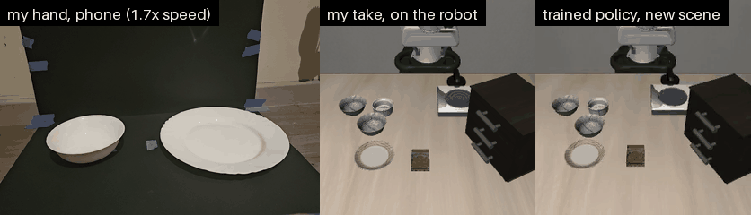
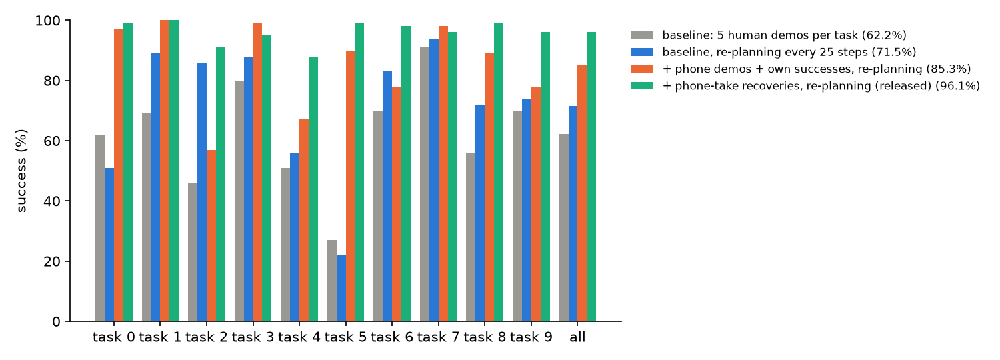
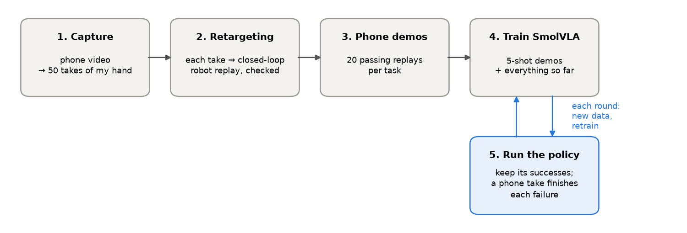
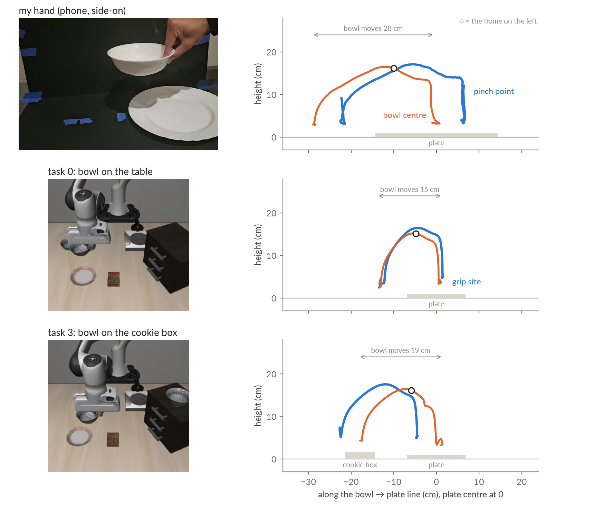
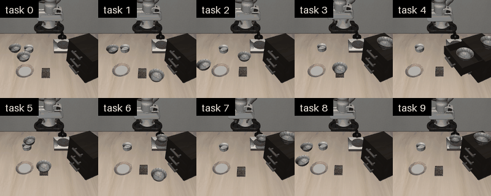
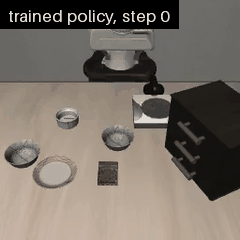

# phone2libero

I filmed my hand moving a bowl onto a plate with a phone, turned the 50 takes into robot demonstrations in
the LIBERO simulator, and used them to train a SmolVLA policy: first as demonstrations, then as corrections that
finish the policy's own failed attempts. On the ten libero_spatial tasks, success goes from **62.2% to 96.1%**
over the same 1000 test episodes.



LIBERO counts a task done when the bowl rests on the plate and ends the episode at that moment. The 5-shot demos
the baseline is trained on stop 3 frames later, and I cut every dataset I made the same way, so the robot never
lets go of the bowl; my hand does.

| Model (SmolVLA) | Training data | Success, 1000 test episodes | vs baseline (points, paired by scene) |
|---|---|---|---|
| Baseline | 5-shot demos: 5 per task, 50 in all | 62.2% | |
| Baseline, re-planning every 25 steps | same | 71.5% | +9.3 |
| Round 1 | 5-shot + 160 phone demos + 200 own successes of an earlier phone-trained model (round 0) | 85.3% | +23.1 |
| **Round 2 (released)** | 5-shot + 160 phone demos + 200 of round 1's own successes + **123 phone-take recoveries** from round 1's failures | **96.1%** | +33.9 |

The last three rows re-plan every 25 steps (chosen on held-out scenes, below). The released model is the best of
three training runs of the round-2 recipe: **96.1%, 92.1% and 92.8%** (mean 93.7%), each about 30 points above
the baseline. Every model is evaluated on the same 1000 episodes (10 seeds x 10 init states x 10 tasks); init
states 0-9 are never used to make data.



Tasks, "pick up the black bowl ... and place it on the plate": 0 between the plate and the ramekin, 1 next to the
ramekin, 2 from table center, 3 on the cookie box, 4 in the top drawer of the wooden cabinet, 5 on the ramekin,
6 next to the cookie box, 7 on the stove, 8 next to the plate, 9 on the wooden cabinet. Table-level: 0, 1, 2, 6,
8; raised: 3, 5, 7; enclosed: 4, 9.

## Try it

Needs Linux, an NVIDIA GPU and [uv](https://docs.astral.sh/uv/).

```bash
git clone https://github.com/kishan-grewal/phone2libero && cd phone2libero
uv sync
uv run just demo          # the trained policy in LIBERO, 10 episodes of one task (~1 min, videos in outputs/evals/)
uv run just replay-take   # one of my takes retargeted onto a LIBERO scene (~20 s, no model, video in outputs/replay/)
```

`uv run just` lists everything else. `just` comes with the dev dependencies, hence `uv run`; if you already have it
installed (e.g. `uv tool install rust-just`), drop the prefix: `just demo`.

The model, datasets and recordings are on Hugging Face:
[phone2libero-smolvla](https://huggingface.co/kishan-grewal/phone2libero-smolvla),
[phone2libero-demos](https://huggingface.co/datasets/kishan-grewal/phone2libero-demos),
[phone2libero-recordings](https://huggingface.co/datasets/kishan-grewal/phone2libero-recordings).

## How it works



**1. Capture** (`capture/`, its own uv environment). One phone films the scene side-on. The camera is
calibrated from the rig itself: the plate outline, the floor card's ends, the backdrop's edges and marks at
known heights ([rig](data/rig.md)). MediaPipe tracks the hand; the bowl is tracked as a known-size rim circle
fitted to its silhouette against the black card. Each recording is cut into takes, and each take gets events
(close, lift, placed, release) and 20 Hz trajectories of the pinch point and the bowl, in cm. The gripper
signal comes from hand-bowl contact rather than finger aperture, which in a side view is small on the approach
and large mid-carry. Output: [data/takes](data/takes), 50 takes from three start distances.

**2. Retargeting** (`plan.py`, `replay.py`). A human hand and a Panda gripper are too different to copy poses, and
the task is defined by where the bowl goes, so the mapping is object-relative. The sim bowl follows the real bowl's
progress along the bowl-to-plate line and its lift in absolute cm; the grip site holds the grasp the 5-shot demos
use on that task (measured from LIBERO's source demos, `demo_grasp.py`); before the grasp and after release, the
gripper follows the hand's motion relative to the bowl. Timing comes from the take, scaled by one factor for all
takes, so speed and style vary from take to take as a human's do. A closed-loop controller turns the path into OSC
delta actions in the 5-shot data's format, recomputed from the robot's actual state every step, so the dataset
records what the robot did rather than the plan. A replay is kept only if LIBERO reports success *and* the bowl was
lifted at least 5 cm, did not slip in the gripper, and no other object moved more than 2 cm.



One take on two scenes. The bowl's progress toward the plate is rescaled to each scene (28 cm on my table, 15 and
19 cm in LIBERO); its lift is kept in cm (13.6 in the take, 12-13 as the robot tracks the plan). While held, the
grip site keeps the 5-shot demos' grasp for that task. On the cookie box the bowl starts 2 cm higher and still
ends on the plate.

**3. Phone demos** (`grid.py`, `dataset.py`). Every take is replayed on every task and on init states 10-49: 50 x
10 x 40 = 20,000 combinations. 94-96% pass on the table-level and raised tasks; 20 passing replays per task, spread
evenly over the takes, become LeRobot episodes written like the 5-shot demos (cameras, state, action scaling,
reward columns).



**4. Training** (`configs/train_smolvla.json`). Every model is SmolVLA trained the way the baseline was:
SmolVLM2-500M weights, a fresh action expert, the vision encoder frozen, batch 32; only the data and the number
of steps change. Each round trains a new model from these weights; what carries over between rounds is data.

**5. Self-improvement** (`selfplay.py`, `recover.py`). The trained policy runs on init states 10-49, in order. One
success per init state goes back into the training set, until there are 20 per task. In round 2 its failures are
used too: when the gripper has closed on nothing (closed, and more than 6 cm above the bowl), or there is no
success by step 150, the simulation is frozen at that moment and a phone take, planned from wherever the arm and
the bowl now are, finishes the episode. Only the take's part is recorded, and only if it passes the replay checks,
so the episode starts where the policy went wrong and contains none of the miss. 123 of 143 such states gave a
passing recovery.



**At test time** the policy predicts 50 actions at a time; it executes the first 25 and predicts again
(`n_action_steps`, set to 25 in the released model's config).

## What I found

Before round 2 the policy never retried. After a missed grasp it carried the empty gripper to the plate and
hovered there: only 6 of round 1's 853 successes came after step 150 of 280. Round 2, trained on the recoveries
(and for 60k steps instead of 40k), has 42 of 961 and reaches 96.1%, up from 85.3%. The
largest gains are on the tasks round 1 missed most: task 2 57% -> 91%, task 6 78% -> 98%, task 9 78% -> 96%.

Executing 25 of the 50 predicted actions before predicting again, instead of all 50, added 9.3 points to the
baseline, 7.2 to round 1 and 11.6 to round 2 (84.5% -> 96.1%). Round 2 gains most: its own data was collected at
25, and a retry needs the policy to look again after a miss. I chose 25 on held-out init states 10-49 with the
round-1 model (50: 85.5%, 25: 90.0%, 10: 89.5%), before any test run at 25. Re-planning does not account for the
data's effect: at 25, the baseline gets 71.5% and round 1 85.3%.

Every task needed data of its own. The first model had phone demos for the five table-level tasks only. Those
went from 61% to 79%, but the other five collapsed from 64% to 1%: given "pick up the black bowl on the cookie
box", it carried a bowl from the table to the plate instead. With 125 demos on the table-level tasks and 25 on
the rest, the table-level motion won out. Retargeting the takes onto the raised starts too (cookie box, ramekin,
stove) brought those tasks back (task 5: 27% -> 81%). The drawer and cabinet tasks (4 and 9) stayed near 0% until
they had data as well, either retargeted takes or the baseline's own successful runs. On the cabinet the two did
equally well (48% and 51%); on the drawer the robot's own runs trained better (58% vs 28%).

Training runs of the same recipe differ by about 4 points. Three runs of round 2, identical except for the training
seed, scored 96.1%, 92.1% and 92.8%; most of the spread is the drawer task (88%, 63%, 73%), the one task with no
recoveries. The intervals in this README cover evaluation noise only, so a few points between two single runs is
within this spread.

I also trained a small CNN that estimates the bowl and plate positions from the robot's camera image, so that takes
can be planned without reading those positions from the simulator. Rebuilding the phone demos and the recoveries
from its estimates and retraining with round 2's recipe gave 94.4% (one run), within the 92.1-96.1% of the three
round-2 runs. The CNN was trained on frames labelled by the simulator, and the replay checks and the takeover
trigger still read the simulator, so it stays off the main branch for simplicity: code, accuracy and the replay
checks are on the [`estimator`](https://github.com/kishan-grewal/phone2libero/blob/estimator/ESTIMATOR.md) branch.

## What didn't work

| What I tried | What happened |
|---|---|
| A third round of the loop | Round 2's own successes plus 98 recoveries from its failures: 95.2%, 0.9 points below round 2, within evaluation noise. The round-2 model already succeeds in 95% of its rollouts on the held-out scenes the data comes from, so there is little left to correct. |
| Retargeting into the drawer (task 4) | 37% of replays pass, and a policy trained on them scored 28% on the drawer, against 58% with the baseline's own successes (below). |
| Self-improvement from successes alone | Round 1, trained on round 0's own successes, scored 78.1% to round 0's 76.3%, both without re-planning, a difference within evaluation noise. A policy that never retries cannot learn to retry from its clean successes. |
| Re-planning every 10 steps | Matched 25 on the held-out scenes (89.5% vs 90.0%) but lost on task 2 (70% -> 50%). |
| Reranking SmolVLA's sampled action chunks, before the phone data | An oracle scoring each sample with the true sim state reached 75% (from 60%, one seed), which showed that missed grasps cause most failures; a hand-written approach scorer only matched the baseline. |
| The hand-measured camera position | The resting bowl floated 2 cm above the card; the calibration's own fit is used instead ([rig](data/rig.md)). |
| Finger aperture as the gripper signal | In a side view the thumb-index gap is small while reaching and large mid-carry, the opposite of open/closed; hand-bowl contact is used instead. |

The drawer is hard to retarget into. The bowl sits in an open drawer under the cabinet top: both side grasps hit
the drawer walls, the takes lift and carry at the same time, which drags the bowl into the drawer front, and a
rim grasp leaves it hanging off-centre. A near-rim grasp, a lift gate (no motion toward the plate until the bowl
is clear) and steering by the bowl's position got 37% of replays to pass. For the same reason the drawer task
gets no recoveries, and it is the weakest and least stable task of the final model.

The released model still fails 39 of the 1000 test episodes. Replaying them with the simulator state logged (the
replay reproduces all 1000 outcomes), 14 never picked the bowl up, though the gripper closed 3 to 10 times in each;
13 put it on the plate but more than 3 cm from its centre, which LIBERO does not count; 9 dropped it or put it
down away from the plate; 3 were still carrying it when time ran out. The drawer task accounts for 12 of the 39.

## Evaluation

Every model is evaluated on the same 1000 episodes: 10 seeds x 10 init states x 10 tasks. Data only ever comes
from init states 10-49, and settings were chosen there, not on the test episodes. A seed replays the same scene,
so outcomes within a scene are correlated: the 95% intervals resample init states within each task, keeping all
seeds of a scene together, and differences are paired by scene. The released model was picked from three training
runs on the test episodes, so 96.1% is the best of three, and 93.7% their mean.

Images must be 256x256, as in training: lerobot-eval's LIBERO default of 360 costs the baseline 23 points (60% ->
37%). `evaluate.py` and `just eval` set it.

## Reproduce everything

Times on one RTX 4090.

```bash
uv run just download-videos   # recordings (2.6 GB) and the MediaPipe model
uv run just capture           # videos -> data/takes (~45 min, separate env in capture/)
uv run just retarget          # 20,000 replays -> data/phone_* (~2 h, 12 CPU workers)
uv run just selfplay kishan-grewal/phone2libero-smolvla-baseline data/selfplay_baseline "4 9"
uv run just train round0 40000 data/phone_table data/phone_raised data/selfplay_baseline           # ~2 h 45 min
uv run just selfplay outputs/train/round0/checkpoints/last/pretrained_model data/selfplay_round1
uv run just train round1 40000 data/phone_table data/phone_raised data/selfplay_round1
uv run just recover outputs/train/round1/checkpoints/last/pretrained_model data/round2               # ~2.5 h
uv run just train round2 60000 data/phone_table data/phone_raised data/round2/own data/round2/recovered  # ~4 h 15 min
uv run just eval kishan-grewal/phone2libero-smolvla-baseline baseline                               # ~35 min
uv run just eval outputs/train/round2/checkpoints/last/pretrained_model round2 25
uv run just compare baseline round2
```

The baseline ([phone2libero-smolvla-baseline](https://huggingface.co/kishan-grewal/phone2libero-smolvla-baseline))
is the same recipe on the 5-shot demos alone for 20k steps. Every dataset above is on Hugging Face, so any step
can start from there: `uv run just download-demos` puts them in `data/demos/`, and
`uv run just train round2 60000 data/demos/phone_table data/demos/phone_raised data/demos/selfplay_round2 data/demos/recoveries_round2`
retrains the released model.

## Results in detail

Success (%) over 10 seeds x 10 init states per task (1000 episodes per model). "Phone" means retargeted phone
demos, 20 per task. Rows above the line execute all 50 predicted actions; rows below re-plan every 25.

| Run | Extra training data (on top of the 5-shot demos) | Steps | All | t0 | t1 | t2 | t3 | t4 | t5 | t6 | t7 | t8 | t9 |
|---|---|---|---|---|---|---|---|---|---|---|---|---|---|
| baseline | none | 20k | 62.2 | 62 | 69 | 46 | 80 | 51 | 27 | 70 | 91 | 56 | 70 |
| phone, 5 tasks | phone on the table-level tasks 0, 1, 2, 6, 8 | 20k | 39.6 | 93 | 94 | 35 | 1 | 0 | 0 | 82 | 1 | 89 | 1 |
| phone, 8 tasks | phone on 8 tasks (raised starts 3, 5, 7 added) | 20k | 63.7 | 90 | 92 | 39 | 92 | 0 | 81 | 71 | 86 | 86 | 0 |
| phone, 8 tasks, 40k | same | 40k | 68.4 | 98 | 97 | 61 | 93 | 1 | 82 | 68 | 98 | 84 | 2 |
| phone, 10 tasks | phone on all 10 tasks (drawer and cabinet retargeted too) | 40k | 73.7 | 89 | 95 | 51 | 86 | 28 | 94 | 65 | 93 | 88 | 48 |
| round 0 | phone on 8 tasks + 20 baseline successes each on tasks 4, 9 | 40k | 76.3 | 92 | 97 | 31 | 95 | 58 | 88 | 78 | 94 | 79 | 51 |
| round 1 | phone on 8 tasks + 20 of round 0's own successes on every task | 40k | 78.1 | 88 | 86 | 54 | 95 | 67 | 81 | 69 | 87 | 78 | 76 |
| round 2 | phone on 8 tasks + round 1's own successes + 123 recoveries | 60k | 84.5 | 92 | 97 | 52 | 96 | 85 | 86 | 75 | 94 | 84 | 84 |
| | **re-planning every 25 steps** | | | | | | | | | | | | |
| baseline | none | 20k | 71.5 | 51 | 89 | 86 | 88 | 56 | 22 | 83 | 94 | 72 | 74 |
| round 1 | as above | 40k | 85.3 | 97 | 100 | 57 | 99 | 67 | 90 | 78 | 98 | 89 | 78 |
| **round 2 (released)** | as above | 60k | **96.1** | 99 | 100 | 91 | 95 | 88 | 99 | 98 | 96 | 99 | 96 |
| round 2, training seed 2 | as above | 60k | 92.1 | 97 | 100 | 88 | 99 | 63 | 97 | 98 | 94 | 94 | 91 |
| round 2, training seed 3 | as above | 60k | 92.8 | 99 | 98 | 81 | 99 | 73 | 98 | 100 | 97 | 94 | 89 |
| round 2, planned from images | as round 2, phone demos and 115 recoveries planned from the CNN's estimates | 60k | 94.4 | 100 | 100 | 91 | 99 | 72 | 98 | 96 | 95 | 98 | 95 |
| round 3 | round 2's own successes + 123 + 98 recoveries | 60k | 95.2 | 100 | 99 | 86 | 98 | 82 | 98 | 100 | 97 | 98 | 94 |

Paired differences (points, 95% interval; paired by scene):

| Comparison | All | Table-level (0, 1, 2, 6, 8) | Raised or enclosed (3, 4, 5, 7, 9) |
|---|---|---|---|
| phone, 5 tasks vs baseline | -22.6<br>[-28.5, -16.8] | +18.0<br>[+9.6, +26.4] | -63.2<br>[-71.4, -54.8] |
| phone, 8 tasks, 40k<br>vs baseline | +6.2<br>[-0.4, +12.7] | +21.0<br>[+11.4, +30.6] | -8.6<br>[-17.4, +0.4] |
| phone, 10 tasks vs baseline | +11.5<br>[+4.1, +18.5] | +17.0<br>[+7.6, +26.4] | +6.0<br>[-5.2, +17.0] |
| round 0 vs baseline | +14.1<br>[+8.4, +19.6] | +14.8<br>[+6.8, +22.8] | +13.4<br>[+5.4, +21.0] |
| round 1 vs baseline | +15.9<br>[+10.0, +21.5] | +14.4<br>[+5.2, +23.4] | +17.4<br>[+10.2, +24.8] |
| round 2 vs baseline | +22.3<br>[+16.6, +28.1] | +19.4<br>[+11.2, +28.2] | +25.2<br>[+17.6, +33.2] |
| round 2 (released)<br>vs baseline,<br>both re-planning | +24.6<br>[+18.9, +30.4] | +21.2<br>[+12.0, +30.6] | +28.0<br>[+21.2, +34.8] |
| round 2 (released)<br>vs round 1,<br>both re-planning | +10.8<br>[+6.6, +15.3] | +13.2<br>[+6.8, +20.0] | +8.4<br>[+3.0, +14.4] |

The replay grid behind the phone data: 94% of table-level and 96% of raised-start replays pass the checks;
37% on the drawer (task 4) and 48% on the cabinet (task 9).

## Repository

```
capture/                     phone video -> tracked takes (own uv project: MediaPipe's pins conflict with lerobot's)
src/phone2libero/
    libero.py                LIBERO env, reset, sim state save/restore, object positions
    takes.py, plan.py        recorded takes; take -> grip-site path (the retargeting map)
    replay.py                closed-loop replay and pass/fail checks
    grid.py, dataset.py      all takes x tasks x init states; passing replays -> LeRobot datasets
    policy.py, selfplay.py   SmolVLA run as lerobot-eval runs it; record its own successes
    recover.py               own successes + phone-take recoveries from the policy's failures
    evaluate.py              multi-seed eval, paired comparisons by scene
    demo_grasp.py            measure the 5-shot demos' grasp (data/demo_grasp.json)
data/                        takes, rig description, grasp offsets
configs/train_smolvla.json   training recipe
tools/media.py               the figures in this README
```

## Credits

The 5-shot LIBERO demos come from VGAS (Xu et al., 2026,
[arXiv:2602.07399](https://arxiv.org/abs/2602.07399), [code](https://github.com/Jyugo-15/VGAS),
[data](https://huggingface.co/datasets/SemyonXu616/HF_LIBERO_5_SHOT)). Built on
[LeRobot](https://github.com/huggingface/lerobot), [LIBERO](https://github.com/Lifelong-Robot-Learning/LIBERO),
[SmolVLA](https://arxiv.org/abs/2506.01844) and [MediaPipe](https://github.com/google-ai-edge/mediapipe).
